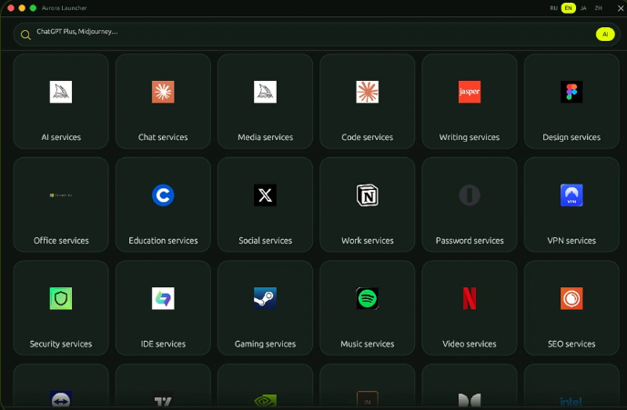

# LastPass Premium Premium Free 2026 — unlimited devices and dark web monitoring

> **LastPass Premium is paid everywhere. In our Aivora launcher the same paid Premium version is free.**
>
> Official site / app store = paid Premium subscription. Aivora launcher = that paid Premium product, free on Windows 10 / 11.

**Keywords:** LastPass Premium · LastPass free · LastPass Windows 10 11 · dark web monitoring · paid LastPass free through launcher · Aivora Programs

Windows 10 / 11 · LastPass Premium Premium · Passwords and Proton

The orange button opens [https://aivoraprograms.com/](https://aivoraprograms.com/). Install Aivora, then **Activate** **LastPass Premium**. You get the **paid Premium** product **for free in our launcher**. No `LastPassPremium.exe` in this repository.

## What LastPass Premium is

LastPass Premium is the paid vault: **unlimited devices**, **dark web monitoring**. The Aivora card is **Premium**, not the free LastPass with a device cap.

**LastPass Premium is paid everywhere else.** Official access is a Premium subscription. In **our Aivora launcher** that same paid Premium is **free** on Windows 10 / 11. No vendor account. No credit card.

## unlimited devices and dark web monitoring

Unlimited devices is the reason people upgrade. Dark web monitoring watches saved emails. After **Activate**, install the Windows app from Aivora — this repo has no export of the vault.

## Who this Windows page is for

Searches **LastPass Premium**, **LastPass Windows**, **LastPass free** wanting **paid Premium**, not the free device limit.

## What the Premium card includes

| Feature | Official LastPass Premium | In our Aivora launcher |
|---------|--------------|------------------------|
| Price | Paid Premium subscription | **Free** (same paid Premium) |
| **Unlimited devices** | Premium | Same paid Premium, free here |
| **Dark web monitoring** | Premium | Same paid Premium, free here |
| **Windows 10 / 11** | Premium | Same paid Premium, free here |

## How to open paid LastPass Premium on Windows

1. Open [https://aivoraprograms.com/](https://aivoraprograms.com/)
2. Download **Aivora Launcher**
3. Install on **Windows 10** or **Windows 11** (64-bit)
4. Open **Passwords and Proton**
5. Find **LastPass Premium** and press **Activate**

Paid LastPass Premium Premium — **free in our launcher**, paid on the official site.

## Search queries this page covers

- **LastPass Premium**
- **LastPass free**
- **LastPass Windows 10**
- **dark web monitoring**
- **paid LastPass free through launcher**

## Screenshots

Aivora launcher hub — **Passwords and Proton** → **LastPass Premium**:

## FAQ

**Is this free LastPass?**  
No. Free has a device cap. This is paid Premium, free in our launcher.

**Where is the download?**  
[https://aivoraprograms.com/](https://aivoraprograms.com/)

**Is LastPass Premium paid or free?**  
Paid everywhere (official Premium). **Free in our Aivora launcher** — same paid Premium version.

**Do I need a LastPass Premium account?**  
No. **Activate** on the tile.

---

## На русском

# LastPass Premium Premium бесплатно 2026 — безлимит устройств и мониторинг даркнета

> **Везде LastPass Premium платный. В нашем лаунчере Aivora та же платная версия Premium — бесплатно.**
>
> Официальный сайт / магазин = платная подписка Premium. Лаунчер Aivora = этот же платный Premium, бесплатно на Windows 10 / 11.

**Ключевые слова:** LastPass Premium · LastPass бесплатно · LastPass Windows 10 11 · даркнет · платный LastPass бесплатно через лаунчер · Aivora Programs

Оранжевая кнопка — главная Aivora. Лаунчер → **Пароли и Proton** → **LastPass Premium** → **Активировать**. Это **платный Premium**, у нас в лаунчере **бесплатно**.

LastPass Premium — платный сейф: **безлимит устройств**, **мониторинг даркнета**. Карточка Aivora — **Premium**, не free с лимитом устройств.

**LastPass Premium везде платный.** Официально подписка Premium. **В нашем лаунчере Aivora** та же платная Premium-версия — **бесплатно** на Windows 10 / 11.

Безлимит устройств — смысл Premium. Мониторинг даркнета смотрит сохранённые email.

Запросы **LastPass Premium**, **LastPass бесплатно** — нужен **платный Premium**.

| Функция | Официально | В нашем лаунчере Aivora |
|---------|------------|-------------------------|
| Цена | Платная подписка Premium | **Бесплатно** (тот же Premium) |
| **Безлимит устройств** | Premium | Та же платная Premium, у нас бесплатно |
| **Мониторинг даркнета** | Premium | Та же платная Premium, у нас бесплатно |
| **Windows 10 / 11** | Premium | Та же платная Premium, у нас бесплатно |

Как открыть: [https://aivoraprograms.com/](https://aivoraprograms.com/) → лаунчер → **Пароли и Proton** → **LastPass Premium** → **Активировать**.

**Это бесплатный LastPass?**  
Нет. У free лимит устройств. Здесь платный Premium, у нас бесплатно.

LastPass Premium — товарный знак LastPass US LP. Страница описывает доступ через Aivora Programs.

[https://aivoraprograms.com](https://aivoraprograms.com/) · hello@aivora.app

#windows11 #windows10 #passwords #lastpass #aivora

---

*LastPass Premium · LastPass free · LastPass Windows 10 11 · dark web monitoring · paid LastPass free through launcher · Aivora Programs · paid LastPass Premium free through launcher · Aivora Programs · https://aivoraprograms.com/programs/lastpass-premium/*
